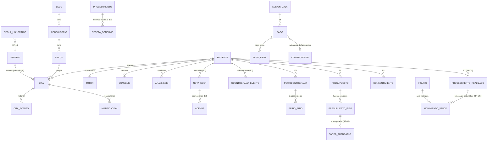

# 3. Modelo de datos

Base de datos: **PostgreSQL 16**. Identificadores `uuid` (salvo la bitácora, `bigserial` para conservar el orden). Fechas en `timestamptz`; la API las devuelve en ISO-8601 UTC y la interfaz las muestra en hora local. Montos en `NUMERIC(12,2)` (nunca `float`). Nombres de tablas y columnas **en español**, igual que en catalogo-multinivel.

Migraciones: `sigo-backend/database/*.sql`, embebidas en el binario (`//go:embed`) y aplicadas en orden por `go run . migrar`. Cada una es **idempotente** (`IF NOT EXISTS`, bloques `DO`), se registra en `schema_migraciones` y se verificó aplicándola dos veces.

Principios:

1. **Lo clínico no se borra.** Las tablas clínicas son *sólo inserción* o tienen triggers que impiden `DELETE` y la edición de registros cerrados (RN-01). Las correcciones son filas nuevas (versiones o adendas).
2. **Las reglas críticas viven también en la BD**, no sólo en la API: superposición de citas (RN-03), inmutabilidad (RN-01, RNF-06), rangos y montos no negativos.
3. **Historial en lugar de sobrescritura** para anamnesis, estados de cita, odontograma y stock.

## 3.1 Etapa 1 — `001_base.sql`

| Tabla | Propósito | Puntos clave |
|---|---|---|
| `usuarios` | Usuarios del sistema | `rol` (CHECK con los 5 perfiles), `password_hash` **bcrypt**, `mfa_secreto` / `mfa_activo` / `mfa_ultimo_paso` (anti-replay TOTP), `intentos_fallidos` / `bloqueado_hasta`, `debe_cambiar_password`, `registro_profesional`. |
| `sesiones` | Estado de servidor de cada JWT | Clave `jti` (id del token), `mfa_verificado`, `ultima_actividad` (inactividad), `expira_en` (máximo absoluto 12 h), `revocada_en` + `motivo_revocacion`. |
| `ajustes` | Parámetros configurables | `seguridad.minutosInactividad` (5–15), `clinica.horasBloqueoNotas` (1–72), `seguridad.maxIntentosFallidos` (3–10), `seguridad.minutosBloqueo` (5–120). Rango validado en la API; caché Redis de 1 min. |
| `auditoria` | Bitácora (RNF-06) | `ocurrido_en`, `usuario_id`, `accion`, `entidad`, `entidad_id`, `ip`, `user_agent`, `detalle` (jsonb), `hash_anterior`, `hash`. Triggers que impiden `UPDATE`, `DELETE` y `TRUNCATE`. |

**Cadena de hashes.** `hash = SHA-256(hash_anterior + JSON canónico del evento)`. La inserción toma un `pg_advisory_xact_lock` para que dos eventos simultáneos no compartan el mismo anterior. `POST /api/auditoria/verificar` recorre la cadena y devuelve el primer registro alterado.

## 3.2 Etapa 2 — `002_pacientes_agenda.sql`

| Tabla | Propósito | Puntos clave |
|---|---|---|
| `sedes`, `consultorios`, `sillones` | Sede → consultorio → sillón | Nombre único dentro de su padre; `activo` para desactivar sin borrar. |
| `procedimientos` | Catálogo | `codigo` único, `duracion_min` 5–480, `arancel NUMERIC(12,2) ≥ 0`. |
| `convenios` | Seguros y convenios | Nombre único, aseguradora opcional. |
| `pacientes` | Ficha única (RF-01) | `UNIQUE (tipo_documento, numero_documento)`; canal preferido y **autorización de mensajes**; trigger que impide `DELETE`. |
| `tutores` | Tutor legal (uno por paciente) | Obligatorio si el paciente es menor de 18 (validado en la API: `TUTOR_REQUERIDO`). |
| `anamnesis` | Anamnesis versionada (RF-02) | `UNIQUE (paciente_id, version)`; alergias en `jsonb`; trigger **sólo inserción** (rechaza `UPDATE`/`DELETE`). |
| `citas` | Citas (RF-09, RF-10) | `CHECK (fin > inicio)`, estados por `CHECK`, **`EXCLUDE USING gist` por sillón** (RN-03), trigger que impide `DELETE`. |
| `citas_eventos` | Historial de estados | Sólo inserción. |
| `notificaciones` | Confirmación y recordatorios 48 h / 24 h (RF-11) | `estado` (PENDIENTE, ENVIADO, FALLIDO, CANCELADO, OMITIDO), `motivo`, `proveedor`, `simulado`, `id_proveedor`, `intentos`. |

### RN-03 en SQL

```sql
ALTER TABLE citas ADD CONSTRAINT citas_sin_superposicion_por_sillon
  EXCLUDE USING gist (sillon_id WITH =, tstzrange(inicio, fin, '[)') WITH &&)
  WHERE (estado NOT IN ('CANCELADO', 'NO_ASISTIO'));
```

- El intervalo `[)` permite citas consecutivas (una termina 10:30 y otra empieza 10:30).
- Como la regla la evalúa PostgreSQL, **dos peticiones simultáneas no pueden pasar ambas** (prueba: 20 en paralelo ⇒ 1 éxito y 19 rechazos).
- La API consulta antes para dar un mensaje claro y traduce el error `23P01` a **409 `SILLON_OCUPADO`** con la cita en conflicto en `extra.conflicto`.
- Un `INSERT` directo en la base también falla (probado en `pruebas/agenda_test.go`).

### Despacho de recordatorios

Una goroutine (`notificaciones.Despachador`) revisa cada 30 s los mensajes vencidos con `SELECT … FOR UPDATE SKIP LOCKED` (varias instancias de la API no envían el mismo mensaje dos veces), hasta 3 intentos. Al cancelar una cita, sus mensajes pendientes pasan a CANCELADO; al reprogramarla, se cancelan y se crean de nuevo.

## 3.3 Modelo completo planificado (Etapas 3–6)



Reglas previstas en la BD:

- **RN-01 (Etapa 3):** trigger `BEFORE DELETE` en `procedimientos_realizados` y `BEFORE UPDATE` que rechaza cambios en un registro realizado; la corrección es una adenda firmada.
- **RF-05 (Etapa 3):** trigger que rechaza `UPDATE` de una nota cuando está firmada o `now() >= bloqueo_en`. `bloqueo_en` se calcula al crearla con el valor vigente de `clinica.horasBloqueoNotas` (cambiar el parámetro no reabre notas antiguas).
- **RN-02 (Etapa 5):** la respuesta del cierre al recepcionista nunca incluye el total teórico; sólo `caja.revisar` (Auditor) lo ve.
- **RF-14 (Etapa 6):** el descargo de insumos ocurre en la **misma transacción** que marcar el procedimiento como realizado.

## 3.5 Convenciones clínicas

### Numeración dental

| Dentición | FDI | Universal |
|---|---|---|
| Permanente (32) | Cuadrantes 1–4, dientes 1–8: 18…11, 21…28, 38…31, 41…48 | 1 (=18) … 8 (=11), 9 (=21) … 16 (=28), 17 (=38) … 24 (=31), 25 (=41) … 32 (=48) |
| Temporal (20) | Cuadrantes 5–8, dientes 1–5: 55…51, 61…65, 75…71, 81…85 | A (=55) … E (=51), F (=61) … J (=65), K (=75) … O (=71), P (=81) … T (=85) |

Se **almacena siempre FDI**; Universal es sólo una forma de mostrar (preferencia del usuario). Así nunca hay dos códigos para el mismo diente en la BD.

Superficies: **M** (mesial), **D** (distal), **O/I** (oclusal en posteriores, incisal en anteriores), **V** (vestibular), **L/P** (lingual en inferiores, palatino en superiores).

### Periodontograma: cálculo del NIC

Seis sitios por diente: mesio-vestibular, vestibular, disto-vestibular, mesio-lingual/palatino, lingual/palatino, disto-lingual/palatino.

- **PS** (profundidad de sondaje): del margen gingival al fondo del surco/bolsa, en mm (≥ 0).
- **MG** (margen gingival): distancia del **límite amelocementario (LAC)** al margen gingival, con esta convención de signo:
  - **positivo** = el margen está **apical** a la LAC (**recesión**);
  - **negativo** = el margen está **coronal** a la LAC (agrandamiento o encía que cubre la LAC);
  - 0 = coincide con la LAC.
- **NIC = PS + MG**

Ejemplos: PS 4 mm con recesión de 2 mm (MG = +2) ⇒ NIC 6 mm. PS 5 mm con margen 2 mm coronal a la LAC (MG = −2) ⇒ NIC 3 mm.

Algunos formularios usan el signo opuesto para el margen (y entonces calculan NIC = PS − MG). El resultado clínico es el mismo; lo importante es que la interfaz rotule la convención junto al campo y que el NIC se calcule en el servidor (columna generada), no a mano.
